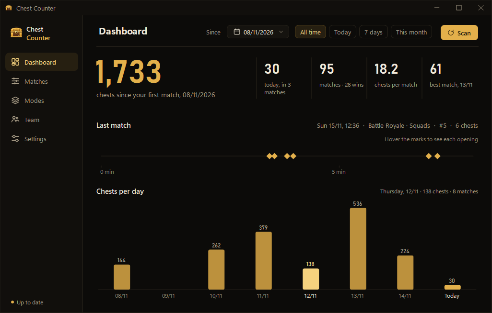
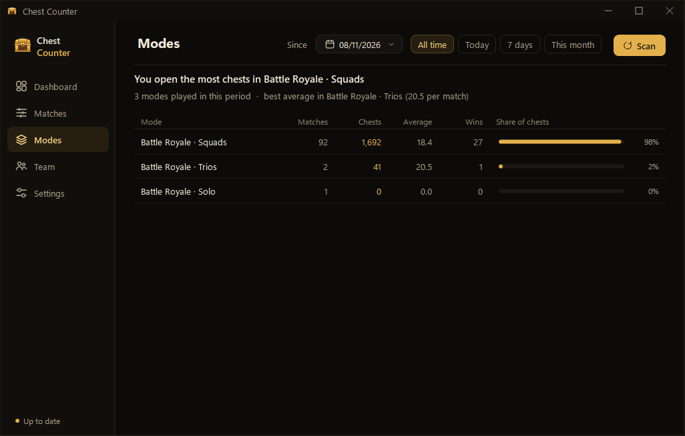
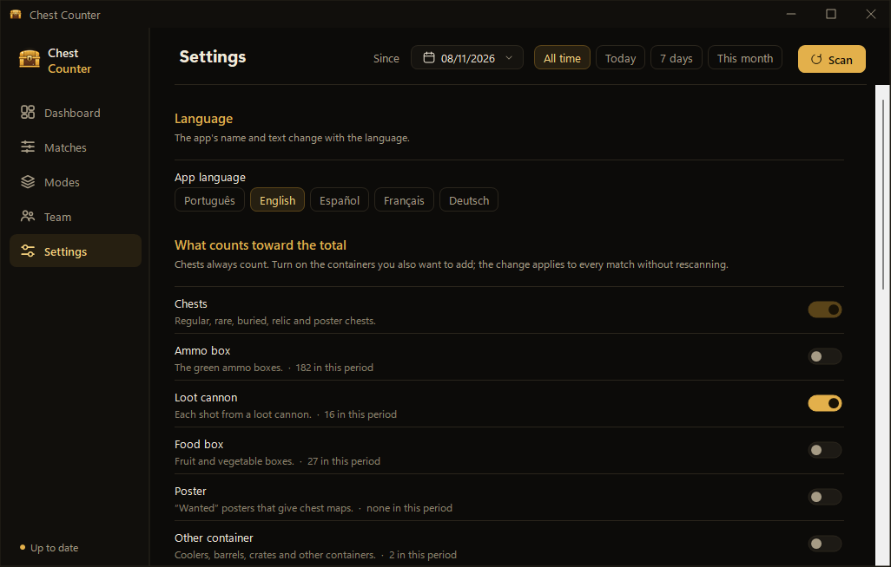
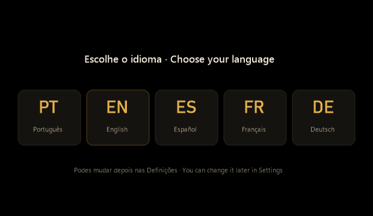
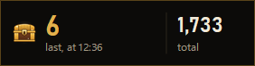

<div align="center">


# ChestCounter

**Counts every chest you open in Fortnite — from your replays, match after match.**

English · [Português](LEIA-ME.md)



</div>

---

ChestCounter reads the `.replay` files Fortnite saves for every match and counts the chests **you** opened, when you opened them, in which mode, and how many your team opened. It only reads replay files: it never touches the game or its memory.

## Features

- **Dashboard** — total chests since a date you pick (or all time), today, matches, average per match, best match, and a **chest rhythm** of your last match (a gold mark at the minute you opened each chest).
- **Matches** — every match with its mode, placement, chests and rhythm. Pick one to see each opening with its time and type (regular, rare, buried, relic, poster), plus **your team's chests** that match.
- **Modes** — matches, chests, average and wins per mode, and each mode's share of your chests.
- **Team** — team total (you + teammates) and every teammate you played with: matches together, chests, average, wins together.
- **Settings** — choose which **extra containers** also count (ammo boxes, loot cannons, food boxes, posters, others; chests only by default), the compact window, start with Fortnite, replay folder, history.
- **Compact window** — a small always-on-top window with the last match and the total. **Lock** it and clicks go through to the game.
- **Start with Fortnite** — a lightweight watcher opens ChestCounter (in the tray) when the game starts.
- **Counts your old matches** — on first launch it reads every replay already on your PC, and keeps the history even after Fortnite deletes old replays.
- **5 languages** — Português, English, Español, Français, Deutsch. The name follows the language (Contador de Baús, Chest Counter, Contador de Cofres, Compteur de Coffres, Truhenzähler).

<p align="center">
  
  
</p>
<p align="center">
  
  
</p>

## Getting started

1. In Fortnite: **Settings → Game → Replays → Record Replays: On**. No replays, nothing to count.
2. Download `ChestCounter.exe` from [Releases](../../releases) (Windows 10/11, single file, no install) — or build it yourself (below).
3. Run it. Windows may say *"Windows protected your PC"* because the exe isn't signed: *More info → Run anyway*.
4. Pick your language on first launch. Your existing replays are counted right away.

> Fortnite only lets a replay be read **after the match ends**, so new chests appear when each match finishes — not live.

## Limits (honest ones)

- A replay only sees what happens near you: a teammate far away may have opened more chests than counted.
- Matches where the game crashed before the end have no readable data.
- Creative / UEFN islands are skipped.
- The compact window needs Fortnite in **Windowed Fullscreen** (it can't draw over exclusive fullscreen).

## Build

Requires the [.NET 10 SDK](https://dotnet.microsoft.com/download/dotnet/10.0).

```bash
build.bat
```

or

```bash
dotnet publish src/ContadorBaus/ContadorBaus.csproj -c Release -r win-x64 --self-contained true -p:PublishSingleFile=true -p:IncludeNativeLibrariesForSelfExtract=true -o dist
```

```bash
dotnet test
```

| Folder | What's inside |
|---|---|
| `src/ContadorBaus.Core` | Replay analyzer, history store, stats (pure, unit-tested), translations |
| `src/ContadorBaus` | Windows app (WinForms, custom-drawn black & gold UI), compact window, Fortnite watcher |
| `lib/` | Replay parser ([FortniteReplayDecompressor](https://github.com/Shiqan/FortniteReplayDecompressor), MIT) with the patches listed in `lib/PATCHES.md` |
| `tests/` | xUnit tests |
| `tools/` | `TesteReplays` (analyze a replay folder from the console), `IconGen` (draws the app icon) |
| `docs/` | Architecture decision record, screenshots |

Data lives in `%AppData%\ContadorBaus\dados.json`.

## Credits

- Replay parsing: [FortniteReplayDecompressor](https://github.com/Shiqan/FortniteReplayDecompressor) © Shiqan (MIT).
- Inspired by and parser patches from [ChestCounter by xdoofy92](https://github.com/xdoofy92/ChestCounter) © LED-N (MIT).

ChestCounter is a fan project, not affiliated with or endorsed by Epic Games. Fortnite is a trademark of Epic Games, Inc.

## License

[MIT](LICENSE) © 2026 waze7
